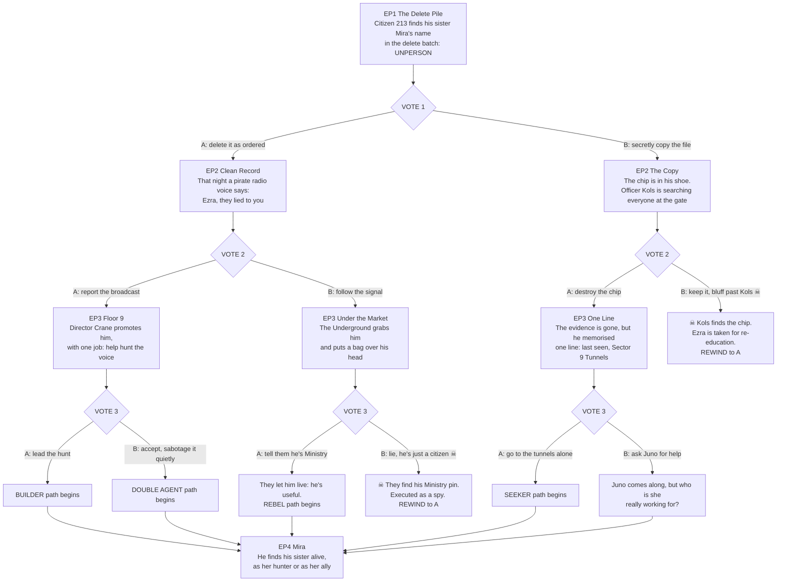

# COMPLIANT: branch map (episodes 1-4)

**Path codes:** each vote adds a letter. `A` = episode 1's vote went A. `A-B` = then episode 2's vote went B.
☠ = a deadly option: it plays out, then the next episode REWINDS to the other option.
All paths rejoin at **Episode 4, "Mira"**, then follow `SEASON1.md`.

## Episode beats

**EP1 The Delete Pile (everyone).** Meridian, the city of the Ministry of Harmony. Ezra Vale, Citizen 213, Grade-3
Records Clerk, loves the order of his job. Batch 4471, forty names, routine. Number 39: **MIRA VALE, UNPERSON**. The
family was told she moved to the eastern farms two years ago. The cursor blinks. Juno, at the next desk, is watching.
**VOTE 1:** A: delete it as ordered. B: secretly copy the file first.

**EP2-A Clean Record.** He deletes her. He can't sleep. At 3 a.m. the stairwell speaker crackles with pirate radio: a
distorted voice, "Static", says *"Ezra. They lied to you about Mira."* It knows his name.
**VOTE 2:** A: report the broadcast (it's the law). B: follow the signal.

**EP2-B The Copy.** The file is on a chip hidden in his shoe. At the gate, Officer Brann Kols is doing random searches,
and the line is moving toward him.
**VOTE 2:** A: destroy the chip before the gate. B: keep it and bluff past Kols ☠.

**EP3-AA Floor 9.** His report reaches Director Crane, who promotes him on the spot and gives him a window office.
His first assignment is to help find the voice called Static.
**VOTE 3:** A: lead the hunt (builder). B: accept, and secretly sabotage the hunt (double agent).

**EP3-AB Under the Market.** He follows the hum to the black market under the old tram station, and a bag goes over his
head. In a candlelit room, masked Underground members ask who he is.
**VOTE 3:** A: tell the truth: he's a Ministry clerk looking for his sister. B: lie, he's just a citizen ☠.

**EP3-BA One Line.** The chip is ash, but he read it once: *last seen, Sector 9 Tunnels.*
**VOTE 3:** A: go to the tunnels tonight, alone. B: ask Juno for help (she clearly knows something).

**☠ deaths:** BB, Kols finds the chip (re-education; the screen cuts to an empty desk); ABB, the Underground finds his
Ministry pin (executed; a candle goes out). Both rewind to the other option.

**EP4 Mira (rejoin).** He finds Mira alive. She's the voice of the Underground broadcasts. On the builder path he finds
her *because he's hunting Static*; on the rebel and seeker paths she finds him. Continue with `SEASON1.md` ep 5.
