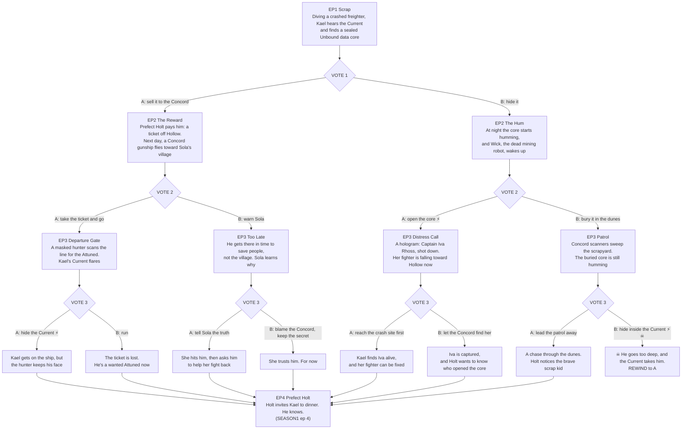

# DRIFTBORN: branch map (episodes 1-4)

**Path codes:** each vote adds a letter. ⚡ = the choice moves the CURRENT meter. ☠ = deadly: plays out, then REWINDS.
All paths rejoin at **Episode 4, "Prefect Holt"**, then follow `SEASON1.md` from ep 4.

## Episode beats

**EP1 Scrap (everyone).** Hollow, a rust-red mining moon under the ringed giant Veyra. Kael Torvin, 19, dives crashed
ships for parts with his partner Sola. Inside a dead freighter he hears it: **the hum**. No one else ever does. It leads
him to a sealed **Unbound data core**. The Concord pays well for those.
**VOTE 1:** A: sell it to the Concord. B: hide it.

**EP2-A The Reward.** Prefect Holt, polite as ever, pays him a ticket off Hollow. The next morning a Concord gunship heads
for the coordinates in the core: **Sola's village**.
**VOTE 2:** A: take the ticket and go. B: race to warn Sola.

**EP2-B The Hum.** In his shack at night, the core starts to hum in time with him, and **Wick**, the 300-year-old mining
robot rusting in the corner, opens its one teal eye.
**VOTE 2:** A: open the core (⚡ +1). B: bury it in the dunes.

**EP3-AA Departure Gate.** The boarding line. A masked Concord hunter, **the Silent One**, scans each face for the
Attuned. Kael's Current flares.
**VOTE 3:** A: hide the Current (⚡). B: run.

**EP3-AB Too Late.** He saves people, not the village. Sola works out where the Concord got the coordinates.
**VOTE 3:** A: tell Sola the truth. B: blame the Concord and keep the secret.

**EP3-BA Distress Call.** The core plays a hologram from **Captain Iva Rhoss** of the Unbound, shot down. Her fighter is
burning across Hollow's sky right now.
**VOTE 3:** A: reach the crash site first. B: let the Concord find her.

**EP3-BB Patrol.** Concord scanners sweep the scrapyard, and the buried core is still humming.
**VOTE 3:** A: lead the patrol away. B: hide inside the Current (⚡ ☠).

**☠ death:** BBB, Kael goes too deep into the Current and doesn't come back (the frame floods teal, then black). REWIND
to A.

**EP4 Prefect Holt (rejoin).** On every path Holt has noticed Kael. He invites him to dinner and lets him know he knows.
Continue with `SEASON1.md` ep 4.
