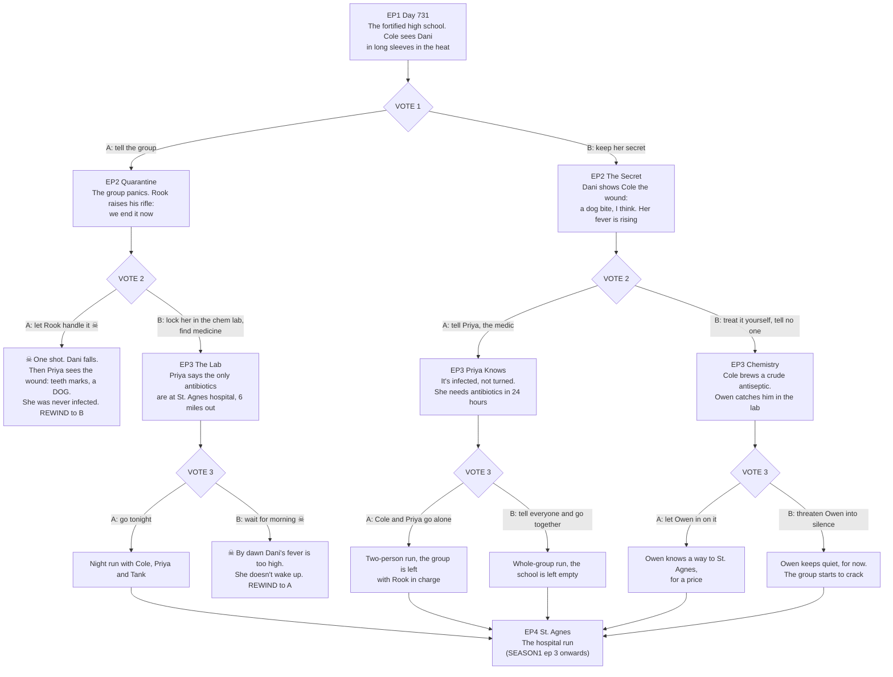

# THE LAST DRAFT: branch map (episodes 1-4)

**Path codes:** each vote adds a letter (`A`, then `A-B`, ...). ☠ = a deadly option: it plays out, then REWINDS.
All paths rejoin at **Episode 4, "St. Agnes"** (the hospital), then follow `SEASON1.md` from ep 4.

## Episode beats

**EP1 Day 731 (everyone).** The fortified high school, two years after the end. Cole Mercer, chemistry teacher, runs
the place like a classroom: roll call, chores, lessons. Supply-run day. He notices Dani wearing long sleeves in 90-degree
heat and flinching when Tank bumps her arm.
**VOTE 1:** A: tell the group Dani is bitten. B: keep her secret and watch her.

**EP2-A Quarantine.** Panic in the gym. Rook steps forward with his rifle: *"Rules are rules. We end it now."* Dani is
crying that it isn't what they think.
**VOTE 2:** A: let Rook handle it ☠. B: lock her in the chem lab and look for medicine.

**EP2-B The Secret.** Alone in the lab, Dani rolls up her sleeve: a ragged wound. *"A dog, I think. Three days ago."* Her
skin is hot, and the edges are red and spreading.
**VOTE 2:** A: tell Priya, the medic. B: treat it yourself and tell no one.

**EP3-AB The Lab.** Dani behind the lab's glass door. Priya's verdict: it's infection, not the virus, but without real
antibiotics she has a day. The nearest are at St. Agnes, six miles through the dead.
**VOTE 3:** A: go tonight. B: wait for morning ☠.

**EP3-BA Priya Knows.** Priya confirms it's a dog bite gone septic, and gives them 24 hours.
**VOTE 3:** A: Cole and Priya go alone (leaving Rook in charge). B: tell everyone and go together.

**EP3-BB Chemistry.** Cole improvises an antiseptic from the old supply closet. It buys time, not a cure. Owen walks in.
**VOTE 3:** A: let Owen in on it (he knows a back way, for a price). B: threaten Owen into silence.

**☠ deaths:** AA, Rook shoots Dani, and only then do they see it was a dog bite: the guilt that rewinds. ABB, waiting
until morning costs Dani her life. Both rewind to the other option.

**EP4 St. Agnes (rejoin).** Every path ends at the hospital. Who's there depends on the votes. Continue with `SEASON1.md`
ep 3 ("St. Agnes") onwards.
