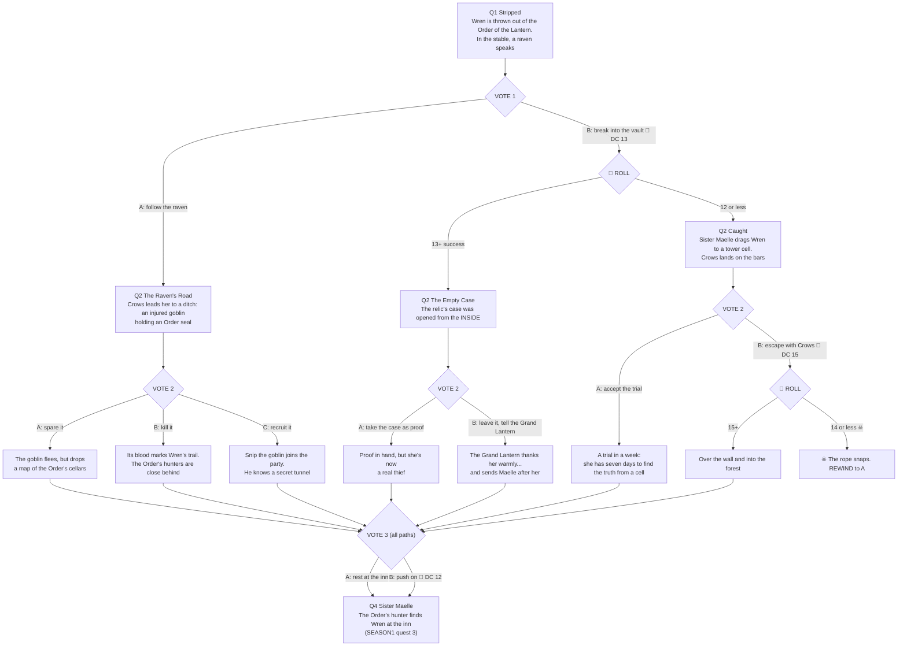

# ROLL FOR FATE: branch map (quests 1-4)

**Path codes:** each vote adds a letter. 🎲 = the move needs a d20 roll (DC shown); the roll decides whether it works.
☠ = a failed roll or deadly choice that kills; it plays out, then REWINDS.
All paths rejoin at **Quest 4, "Sister Maelle"** (the inn), then follow `SEASON1.md` from quest 3.

## Quest beats

**Q1 Stripped (everyone).** The Lantern Hall. Wren Ashby is stripped of the armour that was her father's, for stealing
the Lantern Relic, which she didn't do. That night in the stable a raven lands on the rail. *"I know who took it,"* says
Crows. *"Probably."*
**VOTE 1:** A: follow the raven. B: break into the vault to see the empty case herself (🎲 DC 13).

**Q2-A The Raven's Road.** Crows leads her to a ditch on the king's road: an injured goblin clutching an **Order seal**.
**VOTE 2:** A: spare it. B: kill it. C: recruit it.

**Q2-B (roll 13+) The Empty Case.** The glass case was opened **from the inside**. The relic left by itself.
**VOTE 2:** A: take the case as proof. B: leave it and tell the Grand Lantern.

**Q2-B (roll 12 or less) Caught.** Sister Maelle catches her in the vault and locks her in the tower. Crows at the bars:
*"So. Trial or window?"*
**VOTE 2:** A: accept the trial. B: escape with Crows (🎲 DC 15, ☠ on a fail).

**Q3 (the outcome of vote 2).** One quest showing what that choice led to: spare: the fleeing goblin drops a map of the
Order's cellars. Kill: its blood marks her trail. Recruit: **Snip** joins, and he knows a tunnel. Take the case: proof,
but now she really is a thief. Tell the Grand Lantern: he smiles too warmly and sends Maelle. Trial: seven days in a cell
to solve it. Escape success: into the forest. Escape fail ☠: the rope snaps, then REWIND to the trial.
**VOTE 3 (all paths, as night falls):** A: rest at the Crooked Lantern inn. B: push on through the night (🎲 DC 12; on
a fail she's too exhausted to go on). Either way, Maelle catches up in Q4. On the trial path, the "inn" is the prison's
guardhouse, where Maelle comes to question her.

**Q4 Sister Maelle (rejoin).** However she got here, the Order's hunter finds Wren at the Crooked Lantern inn. Continue
with `SEASON1.md` quest 3.
